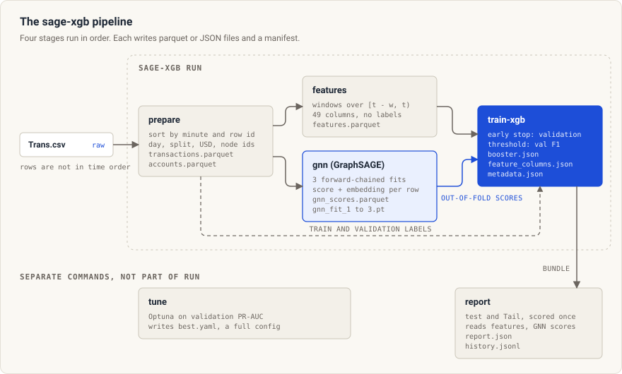
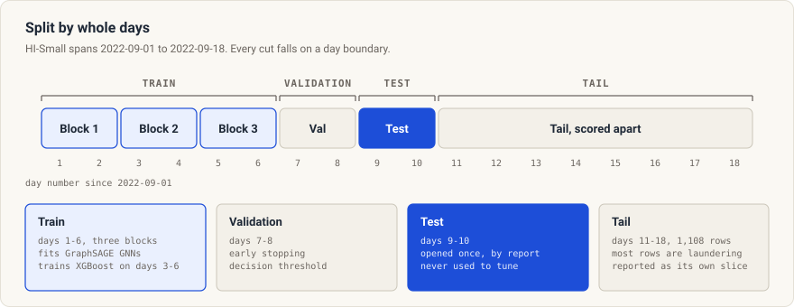
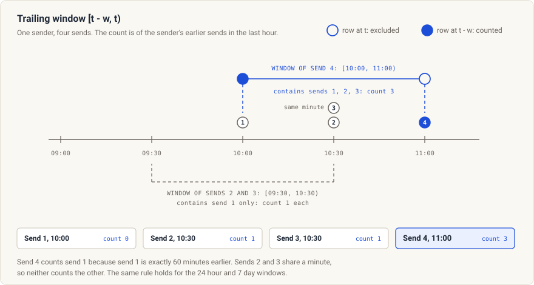
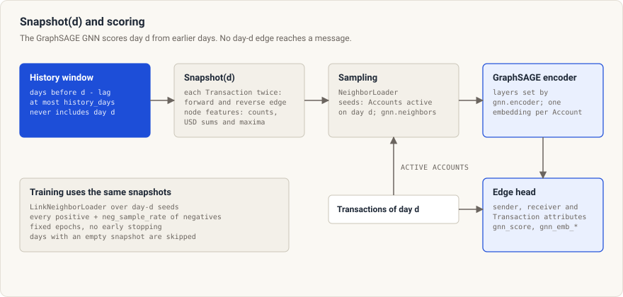
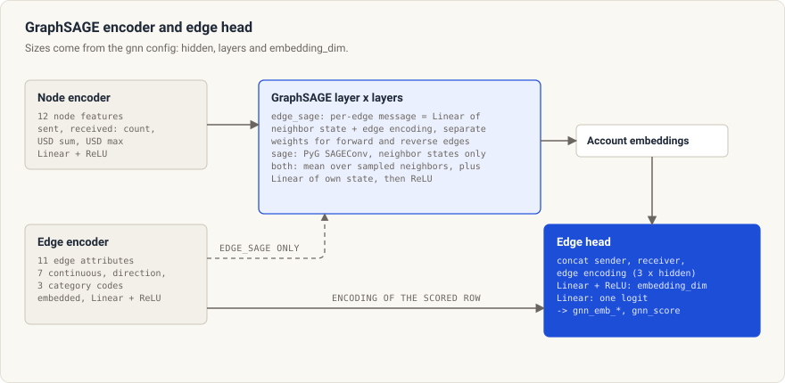
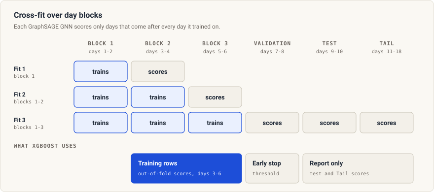
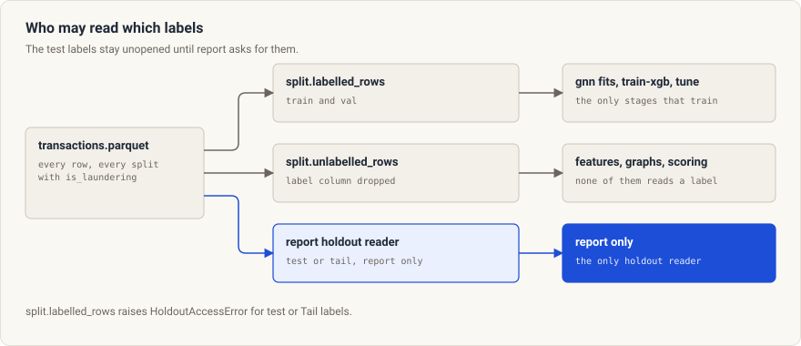

<h1 align="center">GraphSAGE + XGBoost</h1>

<h3 align="center">GraphSAGE scores and embeddings as features for XGBoost, to flag money-laundering transactions in IBM AMLworld.</h3>

<div align="center">

[](pyproject.toml)
[](LICENSE)

</div>

sage-xgb is a training pipeline using GraphSAGE and XGBoost to flag money-laundering transactions in IBM AMLworld. It reads the transactions of one [AMLworld](https://www.kaggle.com/datasets/ealtman2019/ibm-transactions-for-anti-money-laundering-aml) Variant, trains a [GraphSAGE](https://arxiv.org/abs/1706.02216) graph neural network (GNN) on the account graph, and hands the GNN output to an XGBoost classifier together with hand-built account features.

## The pipeline

`sage-xgb run` runs four stages in order. `tune` and `report` are separate commands.

<p align="center">
  
</p>

| Stage | What it does |
| --- | --- |
| `prepare` | Sorts the Transactions by timestamp with the raw row id as tie-break, assigns a day number, a split and a dense node id per Account, and converts amounts to USD with a fixed rate table. |
| `features` | Computes nine row features, 36 trailing-window features and four minutes-since-last features for each Transaction, from the earlier Transactions of its two Accounts. |
| `gnn` | Fits three GNNs on forward day blocks and writes an out-of-fold score and an embedding for each scored Transaction. |
| `train-xgb` | Trains XGBoost on the feature table and the GNN columns, early-stops on the validation split and stores the threshold that maximizes F1 on validation. |
| `report` | Scores the test and Tail slices once, with the stored threshold, and writes bootstrap intervals. It is not part of `run`. |
| `tune` | Searches hyperparameters on validation within a time limit and writes a complete config for the best trial. |

## How it works

### Split and Tail

HI-Small covers 2022-09-01 to 2022-09-10, plus 1,108 late Transactions on 2022-09-11 to 2022-09-18 that form the Tail. The split cuts on whole days so that a daily graph snapshot holds no partial day. Only `sage_xgb/split.py` turns a timestamp into a split or a day block.

<p align="center">
  
</p>

- The split is chosen by days, close to 60/20/20 of the rows.
- Most Tail rows are laundering and sit after the documented window, so a model could score well on them by recognising "late". The Tail is excluded from the headline slice and reported on its own.
- The three train blocks are the unit of the GNN cross-fit.
- Other Variants need their own day boundaries in their own config.

Read more in [Split and Tail](docs/explanation/split-and-tail.md).

### Features and windows

A Transaction becomes two events, an `out` event for the sender and an `in` event for the receiver. Each Account has one stream of events sorted by minute. A feature for a Transaction at time `t` aggregates a stream over the half-open interval `[t - w, t)` for `w` in 1 hour, 24 hours and 7 days.

The rule has three consequences. The Transaction never counts itself. Transactions in the same minute never count each other, so a live Transaction and its replay in training see the same history. A Transaction exactly `w` minutes earlier is counted.

Take one sender with four sends, at 10:00, 10:30, 10:30 and 11:00. The diagram shows the 1-hour send count of each send.

<p align="center">
  
</p>

- Each window gives the count, the USD sum and the USD maximum, for both the sender and the receiver, over both the `out` and the `in` stream.
- Minutes since the last event come from an as-of join that excludes the current minute.
- Category codes come from fixed lists in `sage_xgb/data/vocab.py`, so nothing is fitted and a cut in the data cannot change a code.
- The label never enters a feature. The truncation, same-minute, window-edge, row-order and label-flip tests guard these rules.

Read more in [Features](docs/explanation/features.md) and [Leakage rules](docs/explanation/leakage-rules.md).

### Snapshots and the GNN

The GNN scores the Transactions of day `d` from a snapshot of earlier days. Snapshot `d` holds the Transactions of the `history_days` days that end `snapshot_lag_days` days before day `d` starts. A day-`d` edge is never in its own snapshot, so no message can carry the future.

<p align="center">
  
</p>

- Training seeds one day at a time with `LinkNeighborLoader`. Each epoch uses every positive Transaction of the day and a share `neg_sample_rate` of the negatives, with binary cross-entropy and a fixed number of epochs and no early stopping.
- A day with an empty snapshot is skipped in training.
- Scoring embeds each Account that is active on day `d` once, then runs the edge head on every Transaction of the day. The same encoder and the same snapshot definition serve training and scoring.
- The daily Account embedding table is what a later serving refresh would reuse.
- The GNN trains on a sample of negatives, so its scores are logits, not calibrated probabilities. XGBoost reads them as features.

The encoder is a [GraphSAGE](https://arxiv.org/abs/1706.02216) network that samples up to a fixed number of neighbors per layer and averages the neighbor messages. Under the default `edge_sage` layer, each message carries the Transaction encoding, and forward and reverse edges use separate message weights. Under `sage`, the layer is PyTorch Geometric's `SAGEConv`, and its messages carry neighbor states only.

The encoder and the head are small, and every layer works on batch tensors.

<p align="center">
  
</p>

Read more in [GNN to XGBoost hand-off](docs/explanation/gnn-to-xgboost-handoff.md).

### Cross-fit hand-off

XGBoost must not train on GNN scores from a model that saw the scored row's day or label. The GNN is therefore fitted forward over the day blocks. Fit `k` trains on blocks 1 to `k` and scores block `k + 1`. The last fit trains on every block and scores the validation, test and Tail rows.

<p align="center">
  
</p>

- XGBoost trains on days 3 to 6. Days 1 and 2 only supply history and the first GNN fit.
- A guard raises if any score came from a fit that trained on the row's day or a later day.
- Early fits train on fewer labelled days than the last fit. XGBoost therefore sees weaker GNN scores in training than at test time. This is the usual cost of cross-fitting.
- `sage-xgb train-xgb --config <file> --set xgb.use_gnn=false` trains XGBoost without the GNN columns, so you can compare validation results with and without them on your data.

### XGBoost, labels and the report

`train-xgb` joins the feature table with the GNN columns and trains with the `aucpr` metric. It early-stops on the validation rows and stores the F1-maximizing threshold of the validation split in the bundle. The bundle holds the booster, the ordered feature columns, the threshold and a hash of the fixed vocabularies. Scoring raises an error for a missing column and never fills one with zero.

<p align="center">
  
</p>

- `report` scores `test` and `tail` separately with the stored threshold and never picks a threshold itself.
- It writes PR-AUC, F1, precision at k and Poisson-bootstrap 95 percent intervals, and it appends one line to `history.jsonl` for each slice it reads, with the slice name, the bundle hash and the time. The line is written before the slice is scored, so the number of times the labels were read is on record even if a later step fails.
- `split.labelled_rows` raises `HoldoutAccessError` when asked for test or Tail labels, and `report` has its own private reader for those two slices. `report` also raises `StaleArtifactError` when a stage up to `train-xgb` is missing or out of date for the config. A test flips every test and Tail label, reruns the pipeline and checks that the bundle, the validation metrics and the GNN scores do not change.

### Tuning

`tune` runs an Optuna study with the TPE sampler and a SQLite store, so it resumes. Each trial fits the last out-of-fold GNN, scores the last training block and the validation days, trains XGBoost on that block and returns the validation PR-AUC. It never loads test or Tail rows. The study stops at `tune.n_trials` or `tune.timeout_minutes`. It writes `best.yaml`, a complete config that `sage-xgb run --config` accepts as the refit at full size. See [Tune hyperparameters](docs/how-to/tune-hyperparameters.md).

### Tracking and skipping

- Each stage writes `manifest.json` with a hash of the config sections it reads, the digests of its upstream manifests, the package version and its output file names. It holds no timestamps, so a rerun with the same inputs writes the same bytes.
- `run` skips a stage whose manifest still matches. `--force` reruns every stage, and `--from-stage NAME` reruns that stage and the ones after it.
- A stage deletes its own manifest when it starts, so a run that stops half way is never mistaken for a finished one.
- MLflow logs one parent run named `run` with a nested run per stage: flattened config values, the stage metrics, the duration and the manifest. The store is `artifacts/mlflow.db`, or `MLFLOW_TRACKING_URI` if you set it. MLflow telemetry is switched off.

See [Training pipeline](docs/explanation/training-pipeline.md) and [Read runs in MLflow](docs/how-to/read-runs-in-mlflow.md).

## Quick start

You need python and uv.

```bash
git clone https://github.com/ontogr/sage-xgb.git
cd sage-xgb
make sync
make train-sample
```

The sample run passes the committed sample under `tests/fixtures/amlworld_hi_small_sample/` through every stage. It writes this tree:

```text
artifacts/
  mlflow.db
  mlartifacts/
  hi-small-sample/
    prepare/     transactions.parquet  accounts.parquet  manifest.json
    features/    features.parquet  manifest.json
    gnn/         gnn_scores.parquet  gnn_fit_1.pt  gnn_fit_2.pt  gnn_fit_3.pt  manifest.json
    train-xgb/   booster.json  feature_columns.json  metadata.json  metrics_val.json  manifest.json
```

Then score the held-out slices once and open the MLflow UI:

```bash
uv run sage-xgb report --config configs/sample.yaml
make mlflow-ui
```

`report` adds `artifacts/hi-small-sample/report/report.json` and `history.jsonl`.

To download the dataset, you need Kaggle credentials. [Train on HI-Small](docs/tutorials/train-on-hi-small.md) walks through the download and the run.

| Command | What it runs |
| --- | --- |
| `make sync` | Installs the locked dependencies, the dev group and all extras |
| `make train-sample` | `sage-xgb run` with `configs/sample.yaml` |
| `make download` | Copies the HI-Small files from Kaggle into `data/` |
| `make train` | `sage-xgb run` with `configs/hi_small.yaml` |
| `make tune` | `sage-xgb tune` with `configs/hi_small.yaml` |
| `make report` | `sage-xgb report` with `configs/hi_small.yaml` |
| `make mlflow-ui` | The MLflow UI on the SQLite store in `artifacts/` |

## GNN settings

The `gnn` section of the config sets the size of the model and the work per fit. The `configs/hi_small.yaml` column shows the values that file sets.

| Key | What it controls | `configs/hi_small.yaml` |
| --- | --- | --- |
| `hidden` | Width of the Account and edge states | 64 |
| `layers` | Number of message-passing layers, one entry in `neighbors` each | 2 |
| `encoder` | GraphSAGE layer type. `edge_sage` messages carry the Transaction attributes, and `sage` (PyTorch Geometric's `SAGEConv`) messages use neighbor states only | Not set, so the default `edge_sage` applies |
| `embedding_dim` | Number of `gnn_emb_*` columns | 8 |
| `neighbors` | Neighbors sampled per layer | `[10, 5]` |
| `neg_sample_rate` | Share of negative Transactions used as seeds each epoch | 0.05 |
| `epochs` | Passes over the seeds, with no early stopping | 2 |
| `batch_size`, `score_batch_size` | Seeds per training step, Accounts per scoring step | 2048, 8192 |
| `snapshot_lag_days`, `history_days` | Days between a snapshot and its scored day, days of history in a snapshot | 0, 7 |

Larger values cost more time and memory. See [Scale the GNN](docs/how-to/scale-the-gnn.md) and the [config reference](docs/reference/config.md).

## Docker

The `train` target of the Dockerfile installs the locked dependencies without the dev group or extras. Its entrypoint runs `sage-xgb` as the non-root user `sage` (UID 10001), and the image holds the configs and the committed sample. The image is built for `linux/amd64` only, because the lock installs `pyg-lib`, the neighbor sampler, only on linux x86_64. On an ARM host it runs under emulation.

```bash
make docker-build
docker run --rm sage-xgb:train --version
```

Run the sample through the image and keep the outputs on the host. The `--user` option keeps the files owned by you, because the default user cannot write to a folder that you own, and the home directory must be writable.

```bash
mkdir -p artifacts
docker run --rm --user "$(id -u):$(id -g)" -e HOME=/tmp \
  -v "$PWD/artifacts:/app/artifacts" \
  sage-xgb:train run --config configs/sample.yaml
```

The image excludes `.env` and does not install the `kaggle` extra, so the `download` stage cannot run inside it. Run `make download` on the host, then mount `data/` into the container for a full run.

## Repository map

```text
sage_xgb/
  cli.py            argparse entry point, one subcommand per stage
  config.py         pydantic config models, YAML load with extends and --set
  settings.py       Kaggle and MLflow settings from the environment
  artifacts.py      artifact paths, manifests, the skip check
  split.py          the only split definition, day blocks, label access
  pipeline.py       run, execute_stage, skipping and the duration table
  tracking.py       the MLflow boundary
  train_xgb.py      XGBoost training, the model bundle, input joins
  tune.py           Optuna study over the proxy trial
  data/             download, load, prepare, fixed vocabularies
  features/         window features and the feature table
  gnn/              snapshots, model, one fit, cross-fit plan
  evaluation/       metrics and the report stage
configs/            one YAML per Variant, plus the sample config
docs/               tutorials, how-to guides, reference, explanation
scripts/            sample builder, diagram builder and docs checker, not shipped
tests/              unit, e2e and integration tests, and the committed sample
```

## Documentation

- [Train on the sample](docs/tutorials/train-on-the-sample.md) runs every stage on the committed sample, which needs no Kaggle account.
- [Train on HI-Small](docs/tutorials/train-on-hi-small.md) downloads the full Variant and trains the model.
- [Tune hyperparameters](docs/how-to/tune-hyperparameters.md) searches the configured ranges on validation PR-AUC.
- [Read runs in MLflow](docs/how-to/read-runs-in-mlflow.md) finds the logged settings, metrics and manifests of each run.
- [Add a Variant](docs/how-to/add-a-variant.md) lists what a new AMLworld Variant needs in its config and code.
- [Scale the GNN](docs/how-to/scale-the-gnn.md) explains which GNN keys change the model size and the work per fit.
- [CLI reference](docs/reference/cli.md), [config reference](docs/reference/config.md) and [artifact reference](docs/reference/artifacts.md) list the commands, the keys and the files.
- [Training pipeline](docs/explanation/training-pipeline.md), [Split and Tail](docs/explanation/split-and-tail.md), [Leakage rules](docs/explanation/leakage-rules.md), [GNN to XGBoost hand-off](docs/explanation/gnn-to-xgboost-handoff.md) and [Features](docs/explanation/features.md) explain why the pipeline is built this way.

## Development

Run `make test`, `make test-e2e`, `make lint-check`, `make lint-typing` and `make docs-check` before you open a pull request. [Contributing](CONTRIBUTING.md) lists the checks and the pull request rules.

## License

The code is licensed under Apache-2.0. See [LICENSE](LICENSE).
